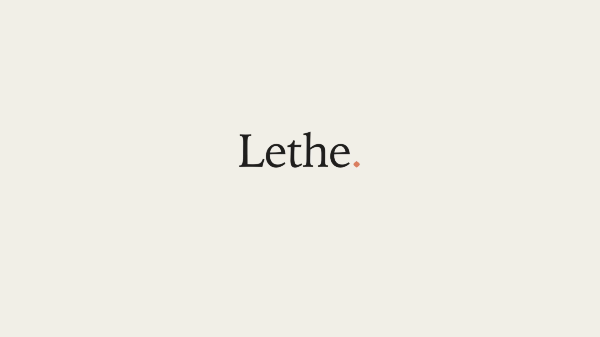

# Lethe

**The privacy layer for AI.** Use GPT, Claude and Gemini at full capability without handing over who you
are. It starts with your own questions; the same layer is meant to sit under every app, service and agent
that calls a model.

Pranjal Joshi · Prashil Bulbule · Vaibhav

[](videos/lethe-film.mp4)

## Videos

| | |
|---|---|
| [**The film**](videos/lethe-film.mp4) | What Lethe is and why, in under two minutes. |
| [**Live demo**](videos/lethe-live-demo.mp4) | The app below running on a laptop against OpenAI: what gets hidden, the sealed request, the answer restored, and the check against OpenAI's stored copy. Recorded on an earlier build; today's app also previews what will be sent as you type. |

## Run the live demo

Needs Python 3.10+ (macOS or Linux; on Windows use WSL) and an OpenAI API key.

```bash
git clone https://github.com/aeropj/lethe && cd lethe && ./demo/run.sh
```

Open http://localhost:8787 and paste your key. It stays in the server's memory only and goes nowhere except
api.openai.com. The first start installs dependencies into `demo/.venv` and downloads the on-device model
(~1.2 GB) and a city list once; after that, detection runs offline. To skip the key screen, put
`OPENAI_API_KEY=sk-…` in `demo/.env` (git-ignored). The server listens on localhost only: it spends your key
and has no login, so do not expose it.

Type a question the way you normally would. As you type, **Will be sent as** shows exactly what would leave
your machine. Click any word to hide it, or any highlight to keep it. If nothing personal is found, Lethe says
so before anything is sent. The answer comes back with your real names put back, on your machine only.

```
you type     i am dhananjay patil, from sambalpur, 62, retired teacher. need help with my 40 lakhs ltcg
OpenAI gets  i am Kai Ashford, from Odisha, 60-something, retired teacher. need help with my 40 lakhs ltcg
```

## What happens when you press Ask

| Party | Gets | Never gets |
|---|---|---|
| **Your device** | everything; finds personal details in ~0.1–0.4 s and keeps the vault | — |
| **Issuer** (at subscribe) | your account and card, and 5 *blinded* credentials it signs | which credential you spend, any prompt |
| **Relay** | your IP and a sealed blob padded to a fixed size | the prompt, the credential, the lab |
| **Gateway** | a valid one-time credential and the scrubbed question | your IP, account, card, real names |
| **OpenAI** | one request with stand-ins | your real details |

- **Finds details on the device.** A multilingual PII model ([GLiNER](https://github.com/urchade/GLiNER),
  `urchade/gliner_multi_pii-v1`) tags people, places, neighbourhoods, organisations, addresses, ages and
  occupations in any casing or typing style. Checksummed patterns add emails, phone numbers for any country,
  cards, IBANs, wallets and national IDs (PAN, Aadhaar, GSTIN, UAN, SSN, NINO, NHS, CPF, SIN and more). A
  GeoNames city list (CC BY 4.0) maps any city, including old names like Bombay or Bangalore, to its state.
- **Swaps, generalises or removes.** People, contacts and organisations become stand-ins that are swapped back
  into the answer. Cities become their state, exact ages a decade, occupations a category, well-known
  employers their kind ("a big tech company"). IDs, cards, street addresses and postcodes are removed.
- **Blind credentials** (RSA-FDH blind signatures, the idea behind Privacy Pass, RFC 9474/9578) pay for each
  request without saying who you are. Each is single-use: a replayed request is refused.
- **Sealed requests** (X25519 + HKDF + ChaCha20-Poly1305, the shape of Oblivious HTTP, RFC 9458), padded to
  fixed sizes, so the relay learns nothing from length.
- **Observability.** Every request is traced in nine timed steps with the real bytes at each step: the swap,
  the sealed request as hex, what the relay saw, the gateway's check, the exact OpenAI call, the restore.

Demo-grade: real primitives, one process, not audited. In this local demo every party runs on your machine
with your key, so OpenAI still sees your account and IP. Hiding those needs the relay and gateway run by
separate operators.

## Check it on OpenAI's side

The app shows what it sends. These steps confirm from OpenAI's own records that it received stand-ins only.

1. **Use a dedicated project.** On [platform.openai.com](https://platform.openai.com) create a project named
   `lethe-demo` and a key for it, so Logs and Usage show only this demo.
2. **Leave Verification mode on** (the default). Requests then carry `"store": true`, so OpenAI keeps them for
   up to 30 days and you can fetch them back.
3. **Ask a question, then open its trace.** Note the response ID (`resp_…`) and request ID (`req_…`); the
   terminal running `run.sh` logs both too.
4. **In the app:** press **Verify with OpenAI**. It fetches the input OpenAI stored and searches it for every
   private detail you typed, e.g. "0 of 5 private details found".
5. **Yourself, without the app:**
   ```bash
   curl -s https://api.openai.com/v1/responses/resp_XXXX/input_items -H "Authorization: Bearer $OPENAI_API_KEY" | python3 -m json.tool
   ```
   Pipe it to `grep -i "your real name"`; it should print nothing.
6. **In the dashboard:** [Logs → Responses](https://platform.openai.com/logs?api=responses), project
   `lethe-demo`: the **Input** shows stand-ins. [Usage](https://platform.openai.com/usage) counts every
   request. Both can lag by a few minutes.
7. **Clean up:** `curl -X DELETE https://api.openai.com/v1/responses/resp_XXXX -H "Authorization: Bearer $OPENAI_API_KEY"`.
   Turn Verification mode off in the key menu for normal use, and revoke the demo key when done.

## How well detection works

Reproducible with `python demo/eval/run_eval.py [cases|heldout|india]` (results in [demo/eval](demo/eval)):

| | 45 tuning prompts | 30 fresh prompts | 12 Indian prompts |
|---|---|---|---|
| Identifiers removed | 98.3% | 100% | 100% |
| Prompts with nothing identifying left | 95.6% | 100% | 100% |
| Exact ages and occupations generalised | 100% | 100% | 100% |
| Useful terms kept | 98.8% | 96.2% | 100% |
| Median detection time, laptop CPU | ~100 ms | ~100 ms | ~300 ms |

The prompts span 13 languages and styles (lowercase, voice-typed, Hinglish, Chinese, Arabic…). The fresh set
was written after tuning. The Indian set (English and Hinglish) found real bugs that were then fixed, so treat
it as tuning data too.

Known limits: names that are ordinary words ("hope and will are getting married"), venue names like hotels,
small neighbourhoods the model is unsure of, and some over-hiding of generic words. Indic scripts such as
Devanagari are not supported yet; romanised Hindi is. The live preview is there for exactly these cases.

## Files

```
demo/run.sh           one command: local environment, install, start
demo/server.py        the five parties, the API and the traces
demo/detect.py        on-device detection: model, ID patterns, city list
demo/scrub.py         stand-ins, generalisation and restore
demo/lethe_crypto.py  blind credentials, sealing, padding
demo/static/          the app (Ask and Observability)
demo/eval/            prompt sets, scorer and results
videos/               the film and the live demo
```

Earlier research, pitch and paper material is kept on the [`archive`](https://github.com/aeropj/lethe/tree/archive) branch.
